# S-Loop

> AI Desktop Workbench — chat, agents, scheduled tasks, platform integrations and a desktop pet, in one Tauri 2 app

[中文文档](README.zh-CN.md)

<p align="center">
  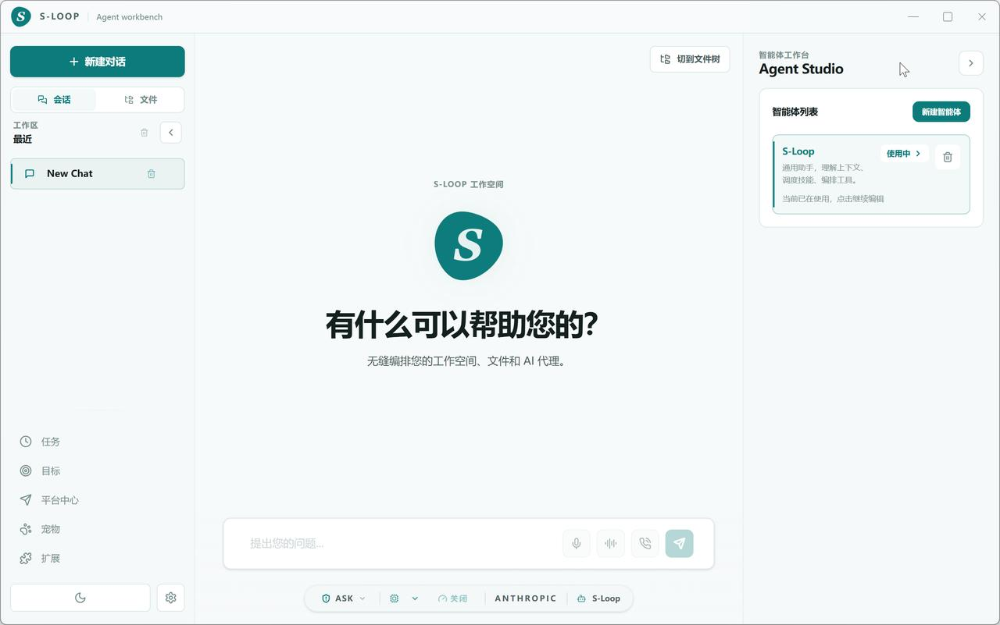
</p>

<p align="center">
  <a href="https://github.com/JeffGuo7/s-loop/actions/workflows/ci.yml"></a>
  <a href="https://github.com/JeffGuo7/s-loop/blob/master/LICENSE"></a>
  <a href="https://github.com/JeffGuo7/s-loop/releases"></a>
  <a href="https://github.com/JeffGuo7/s-loop/stargazers"></a>
  <a href="https://github.com/JeffGuo7/s-loop/releases/latest"></a>
  <a href="https://github.com/JeffGuo7/s-loop/releases/latest"></a>
</p>

## What is S-Loop?

S-Loop is a local-first AI workbench for Windows. One app gives you streaming chat with
39 built-in model providers (DeepSeek, OpenAI, Anthropic, Google, GLM, Moonshot, Qwen and
more), a drag-and-drop agent builder, sub-agents and an autonomous goal loop, cron-style
scheduled tasks, message-platform integrations, offline voice input, and a desktop pet —
backed by a documented security model with workspace sandboxing, durable approvals and an
execution audit trail.

## Features

| Module | Description |
|--------|-------------|
| **AI Chat** | Streaming SSE output, reasoning visualization, tool-call logs, Markdown + Shiki highlighting, Mermaid / KaTeX rendering, table export, built-in previews for PDF / Word / Excel / Markdown |
| **Model Providers** | 39 built-in providers via the pi SDK — DeepSeek, OpenAI, Anthropic, Google, GLM (Z.ai), Moonshot, Qwen, MiniMax, Xiaomi, OpenRouter, xAI, Groq and more — plus custom OpenAI-compatible endpoints; per-provider API keys, model-aware reasoning controls |
| **Agent Builder** | Custom agents (instructions / model / skills / MCP / permission mode), slash commands, drag-and-drop assembly, agent profiles |
| **Sub-agents & Goal Loop** | `delegate_task` / parallel / chained sub-agents with budgets and cancellation; goal loop plans, executes and checks multi-step work with its own approval flow |
| **MCP** | stdio MCP processes managed by the Rust layer; remote Streamable HTTP / SSE servers with OAuth 2.1 + PKCE, per-server tool filters, DPAPI-encrypted credential vault |
| **Skills** | Local `SKILL.md` scanning, remote search & install, ZIP drag-and-drop, CLI integration |
| **Scheduled Tasks** | Cron / interval / one-shot, bound to an agent + skills snapshot, deliver to chat or a platform; unattended runs park on `waiting_for_approval` and resume after a decision |
| **Platform Hub** | Telegram (bidirectional chat sync), Email, Webhook, Feishu, DingTalk, WeChat, Slack, Discord, QQ Bot — whitelist-first access control with rate limiting |
| **Voice** | Fully offline speech recognition (whisper.cpp / sherpa-onnx), Kokoro TTS voices, realtime voice mode |
| **Web Search** | Bing / Brave / SearXNG / Tavily / Exa — five engines, sensible zero-config default |
| **PPTX Generation** | Native PowerPoint generation and workspace preview |
| **Desktop Pet** | SVG animated pet in a transparent overlay window, multi-state, theme packs |
| **Themes** | 9 color schemes × dark/light, glassmorphism, CSS-variable driven |

## Screenshots

<p align="center">
  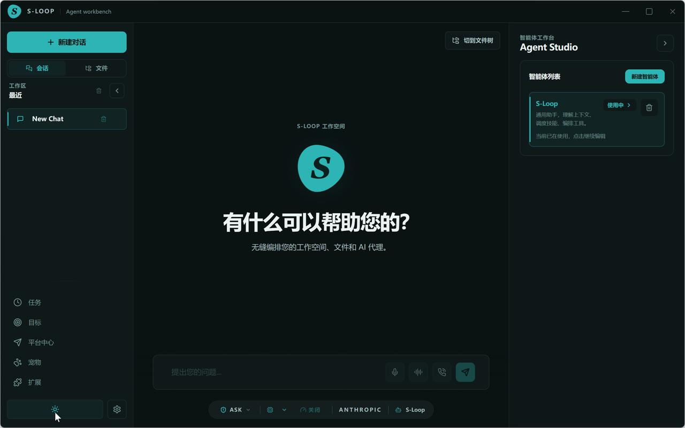
  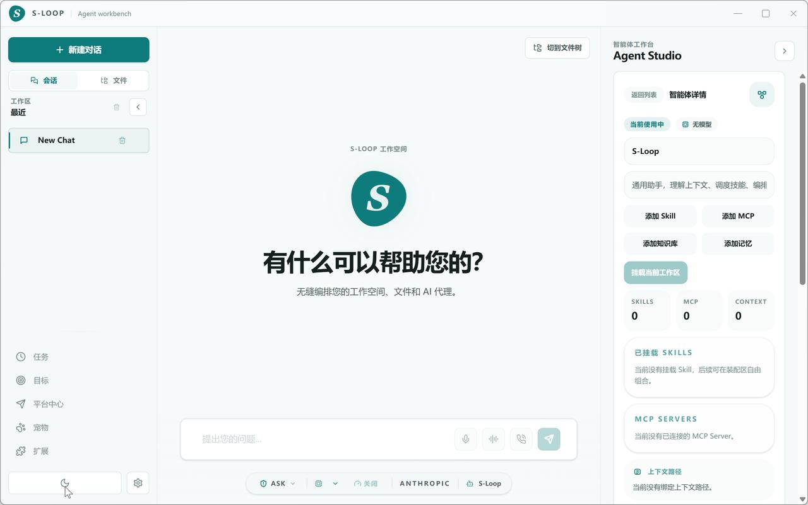
</p>
<p align="center">
  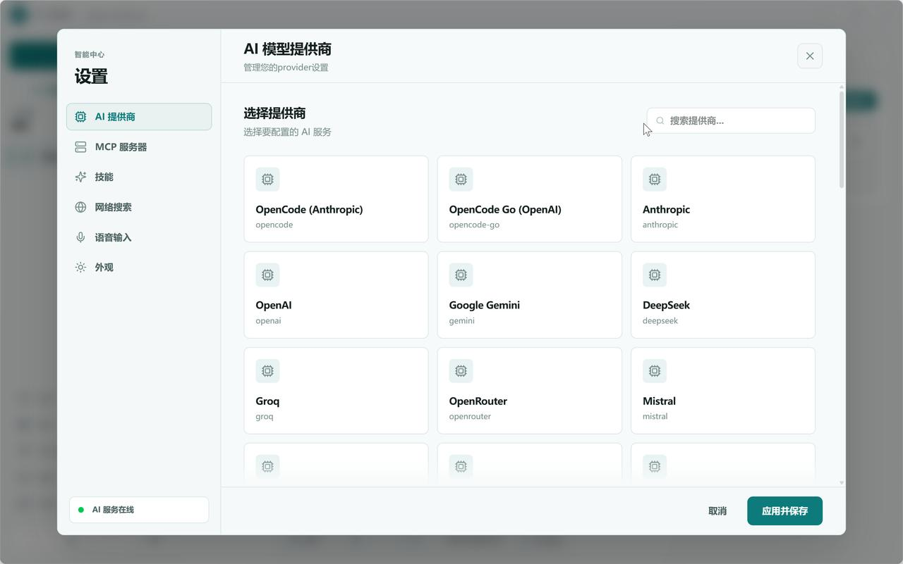
  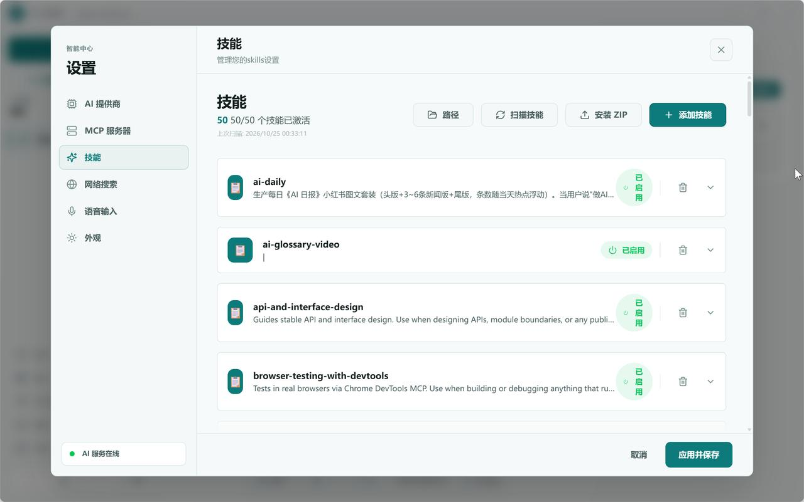
</p>
<p align="center">
  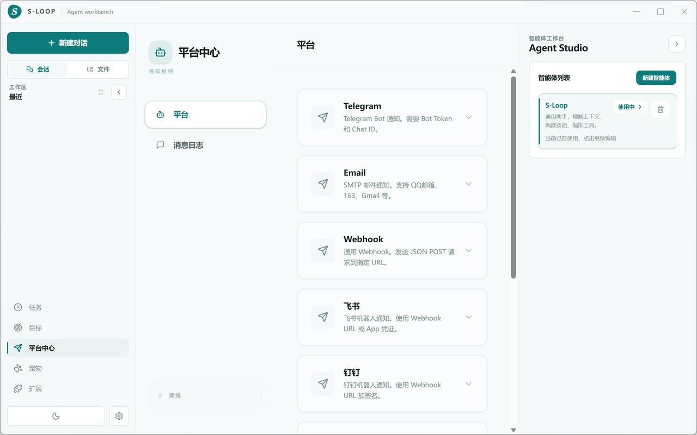
  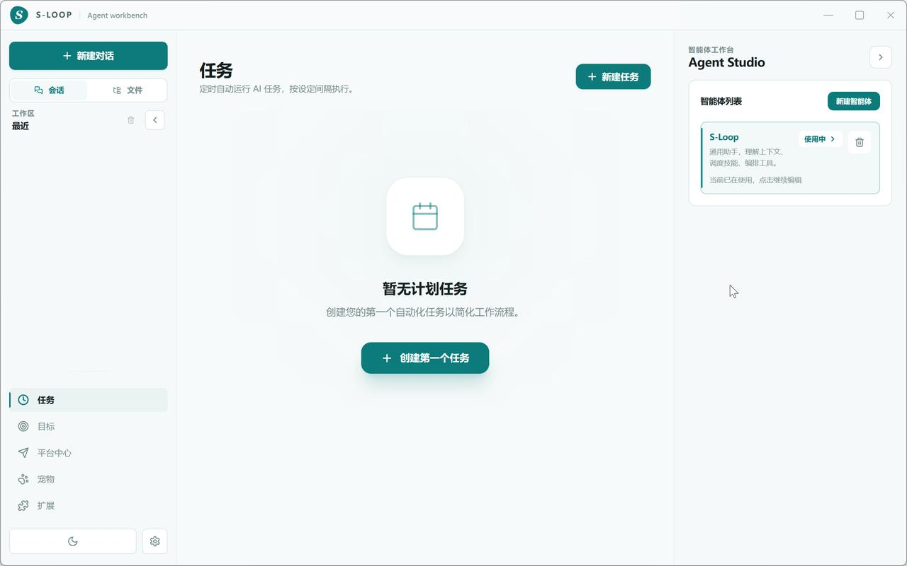
</p>
<p align="center">
  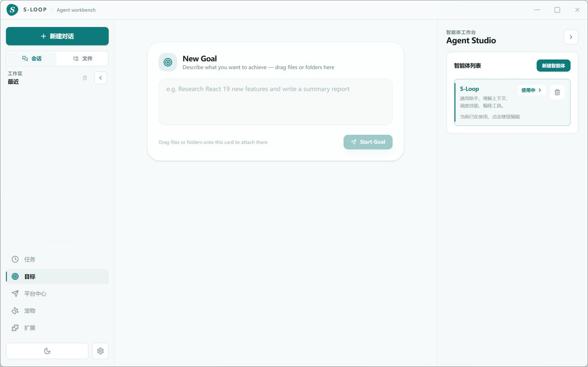
  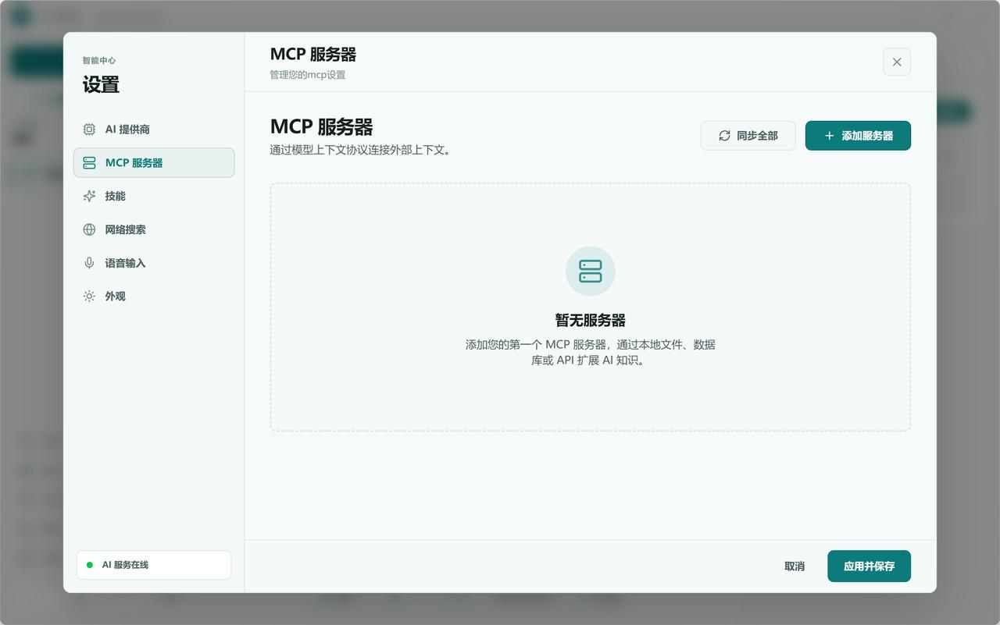
</p>
<p align="center">
  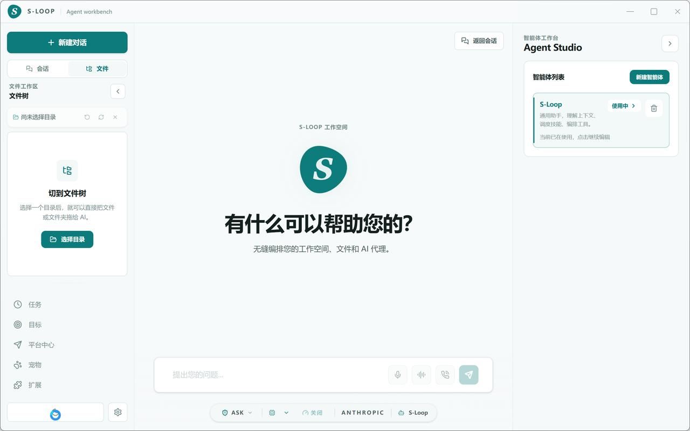
  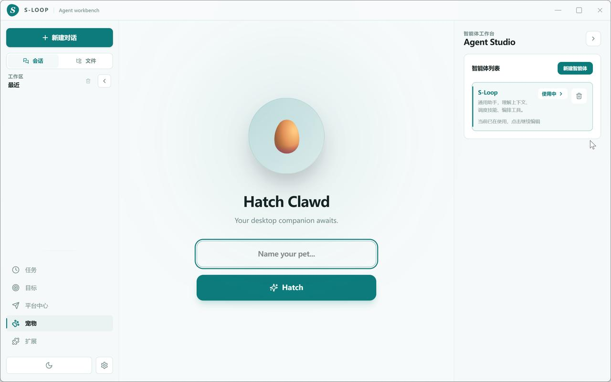
</p>

## Security model

S-Loop treats model output as untrusted input. The full baseline lives in
[docs/security-model.md](docs/security-model.md); the short version:

- The local sidecar requires a **per-launch token** (constant-time verified, passed via
  the child environment, never persisted) and an origin allowlist; only loopback is bound.
- File tools are jailed to **workspace roots with read / read-write separation**; writes
  outside a writable root are refused even in `allow` mode.
- Shell commands pass a **two-tier policy** (hardline-blocked vs. approval-required);
  MCP tools default to ask, unknown tools fail closed.
- Unattended runs **park on approval** and survive restarts; every decision lands in a
  durable, verifiable **audit trail**.
- MCP credentials are encrypted with **Windows DPAPI**; child processes get a sanitized
  environment (no API keys, no `NODE_OPTIONS`), and the whole process tree dies with the app.
- The webview enforces a strict CSP and all model-rendered HTML is sanitized.

## Architecture

```
┌─ Tauri 2 ───────────────────────────────────────────────────────┐
│                                                                  │
│  Rust Backend                     Node.js AI Engine              │
│  ┌────────────────────┐          ┌─────────────────────────┐    │
│  │ pi_server.rs       │◄────────►│ pi-server (HTTP + SSE)  │    │
│  │  sidecar lifecycle │  token   │  sessions & streaming   │    │
│  │ mcp_manager.rs     │          │  routes/* (HTTP API)    │    │
│  │ credential_store   │          │  subagents / goal-loop  │    │
│  │ skill_installer    │          │  task-scheduler (cron)  │    │
│  │ skills_cli         │          │  platform-center (hub)  │    │
│  │ voice / dictation  │          │  execution policy       │    │
│  │ system tray        │          │  approvals / audit      │    │
│  └────────────────────┘          └─────────────────────────┘    │
│                                                                  │
│  React Frontend                                                  │
│  ┌──────────────────────────────────────────────────────────┐   │
│  │ ChatView │ AgentBuilder │ TasksPage │ GoalPage │ PetPage │   │
│  │ SettingsModal │ WorkspacePanel │ MCP │ Skills │ Platforms│   │
│  │ WebSearch │ Preview │ Voice │ i18n │ Themes              │   │
│  └──────────────────────────────────────────────────────────┘   │
│                                                                  │
└──────────────────────────────────────────────────────────────────┘
```

- **Rust layer** — window/tray lifecycle, sidecar spawn with Windows Job Object
  containment and a sanitized child environment, MCP stdio process management, DPAPI
  credential vault, offline speech (whisper.cpp + sherpa-onnx) and Kokoro TTS.
- **pi-server (Node sidecar)** — sessions and streaming, the HTTP route modules
  (`routes/`), tool policy engine, workspace sandbox, sub-agents, goal loop, task
  scheduler, platform hub, durable approvals and the audit store. Packaged as
  `pi-server.zip` and extracted on first launch with a bundled Node runtime.
- **React frontend** — all UI, talking to the sidecar over loopback HTTP + SSE with the
  per-launch token.

## Quick Start

### Development

```bash
git clone https://github.com/JeffGuo7/s-loop.git
cd s-loop
npm install
npm run tauri:dev
```

> Prerequisites: Node.js ≥ 20, Rust ≥ 1.85 (MSVC), npm.
> The first Rust build compiles the bundled speech engine; CI caches the sherpa-onnx
> prebuilt archive.

If you run the Vite dev server and `pi-server` as separate processes, set the same
temporary value in `VITE_S_LOOP_API_TOKEN` and `S_LOOP_API_TOKEN` so the frontend can
authenticate to the sidecar.

### Download (Windows)

Grab the latest installer from the
[Releases page](https://github.com/JeffGuo7/s-loop/releases/latest).

| Format | File |
|--------|------|
| Installer (recommended, per-user) | `S-Loop_<version>_x64-setup.exe` |
| System-wide (MSI) | `S-Loop_<version>_x64_en-US.msi` |

The installer embeds `pi-server.zip`; on first launch the app extracts it next to itself
and starts the sidecar on `127.0.0.1:4096`. No extra configuration required — just paste
an API key for your provider in Settings.

## Testing

```bash
npm test                       # frontend (vitest)
npm run test:server            # pi-server unit + HTTP route smoke tests (node:test)
npm run native:test:speech     # stt crate
cargo test --manifest-path src-tauri/Cargo.toml   # native layer
npx tsc --noEmit               # type check
```

CI (`.github/workflows/ci.yml`) runs the type check, both Node test suites, and gates the
Rust layer on `cargo fmt --check`, `cargo clippy -D warnings` and `cargo test`.

## Build & Release

```bash
npm run tauri:build            # NSIS + MSI installers into src-tauri/target/release/bundle
node scripts/publish-release.mjs --dry-run   # validate, build and locate artifacts
node scripts/publish-release.mjs             # build + create the GitHub release
```

## Project Layout

```
src/                    React frontend (components, stores, i18n, themes)
src-tauri/src/          Rust layer: sidecar lifecycle, MCP manager, credentials, voice
src-tauri/pi-server/    Node AI engine: index.mjs + routes/ + policy/approval/audit stores
stt/                    Rust speech engine (whisper.cpp, sherpa-onnx, Kokoro TTS)
docs/                   Security model and design documents
tests/                  Frontend vitest suite
scripts/                Packaging and release tooling
```

## License

[MIT](LICENSE)
